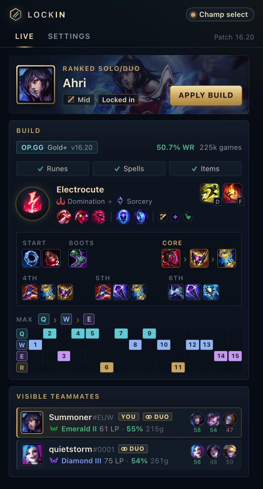
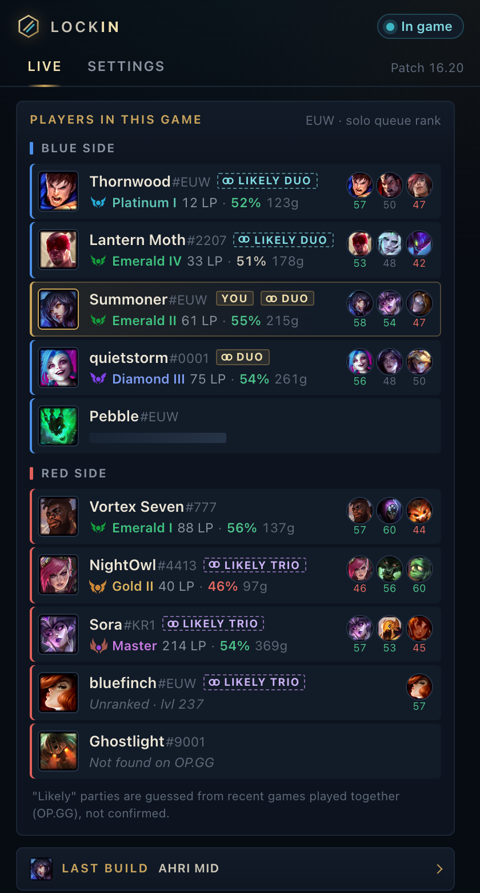
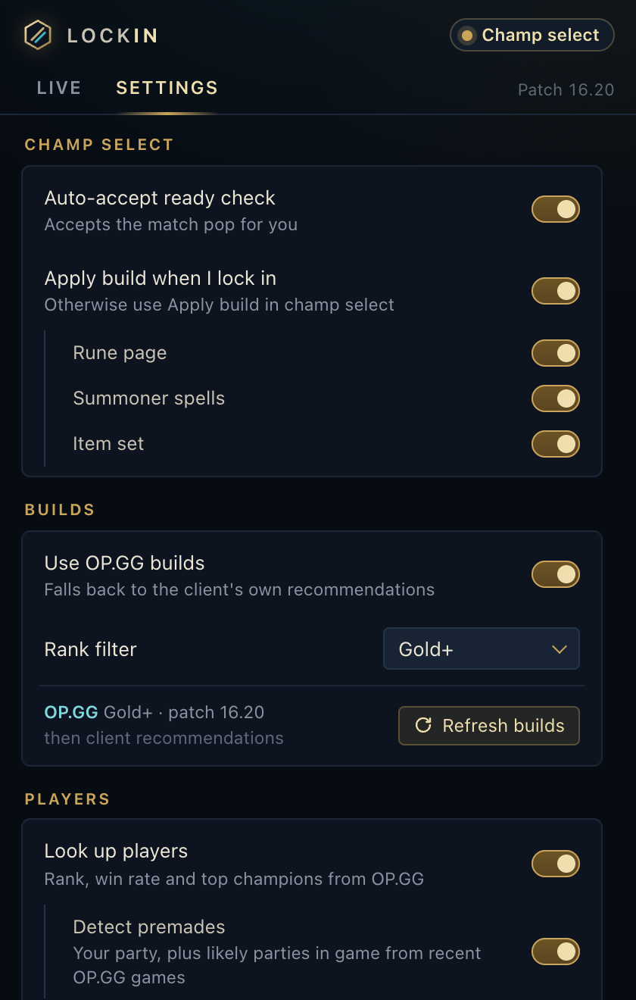

<h1 align="center">Lockin</h1>

<p align="center">
  A lean, ad-free League of Legends companion for Windows and macOS.<br>
  It sits in your tray and does nothing until the League client starts.
</p>

<p align="center">
  <a href="https://github.com/popcornAC/lockin/releases/latest"></a>
  <a href="https://github.com/popcornAC/lockin/actions/workflows/ci.yml"></a>
  <a href="LICENSE"></a>
</p>

<p align="center">
  
  
  
</p>

## Features

- **Auto-accept** ready checks (off by default)
- **Champ select auto-import** of runes, summoner spells and an item set from OP.GG builds, falling back to the client's own recommendations
- **Player lookup** with rank, win rate and top champions for visible players in champ select and all 10 players in game
- **Premade markers** for your own party, plus likely duos inferred in game from recent match history
- **Post-game stats** in a Games tab: your recent games, stat cards, lane comparison and a sortable 10-player scoreboard (from OP.GG, a few minutes after each game)

Summoner's Rift only. No in-game overlay, no memory reading, no Riot API key needed.

## Install

Download the latest installer from [Releases](https://github.com/popcornAC/lockin/releases): the `.exe` for Windows, or the `.dmg` for macOS (`aarch64` for Apple Silicon, `x64` for Intel).

The builds are unsigned:

- **Windows:** on the SmartScreen prompt, click **More info → Run anyway**.
- **macOS:** after moving the app to Applications, run `xattr -cr /Applications/Lockin.app`, then open it.

From v0.2.0 on, Lockin updates itself: Settings → **Check for updates**, then **Install and restart**.

## Build from source

You need Rust (stable), Node 22 and pnpm. On Windows you also need the MSVC Build Tools and WebView2.

```sh
cd app
pnpm install
pnpm tauri dev     # run with logs
pnpm tauri build   # build installers
```

## License

[MIT](LICENSE)

Lockin isn't endorsed by Riot Games and doesn't reflect the views or opinions of Riot Games or anyone officially involved in producing or managing Riot Games properties. Riot Games, and all associated properties are trademarks or registered trademarks of Riot Games, Inc. Build and player data comes from OP.GG; game assets come from Data Dragon and CommunityDragon.
